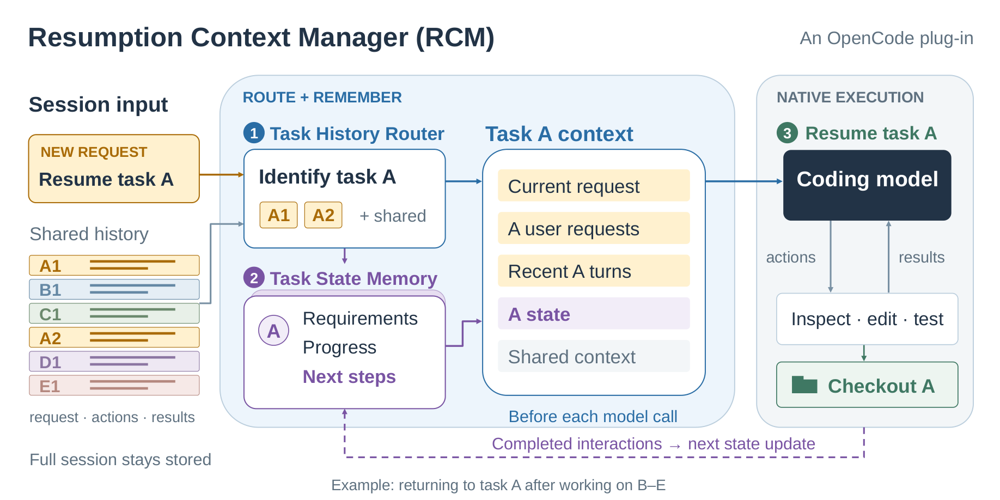

# Switch-SWE

A benchmark for coding agents that switch between unfinished tasks in one conversation.

Each task has two sessions: an uninterrupted **baseline**, and a **switched** session that interleaves the focus task with four other tasks from the same repository. Each task keeps its own checkout; the final focus patch is scored.

| Split | Focus tasks | Interruption locality |
| --- | ---: | --- |
| Near | 100 | Different source files sharing a parent directory |
| Far | 100 | Source files in different parent directories |

**200 tasks · 400 sessions · 19 Python repositories**

## Dataset

- [pairs.json](data/pairs.json): the 200 tasks and their split labels.
- [cases.json](data/cases.json): prompts, turn order and repository commits for both sessions.
- [splits/](data/splits/): near and far task lists.
- [workspace_overlays.json](data/workspace_overlays.json) and [blobs/](data/blobs/): prepared initial source changes.

Requires Python 3.10+:

```sh
python3 scripts/verify_release.py
python3 scripts/inspect_case.py --split near
python3 scripts/inspect_case.py --case-id sf001_switched --turn 0
```

See [workspace preparation](docs/workspaces.md) to build the checkouts. Private grading tests and runtime bundles are maintained separately.

## OpenCode plugin

The **Resumption Context Manager (RCM)** routes conversation history by task and maintains task memory for resumption. This repository includes the selected **v003** plugin, tested with **OpenCode 1.18.2**.



```sh
OPENCODE_UPSTREAM_BIN=/absolute/path/to/opencode \
  ./plugins/context-manager/opencode_plus run "Your coding request"
```

Modes: `off` for native context, `a` for task routing, and `x` (default) for routing plus memory. See the [plugin guide](plugins/context-manager/README.md) for provider configuration and usage.

## More

[Data card](docs/data-card.md) · [Evaluation](docs/evaluation.md) · [Provenance](docs/provenance.md) · [Tests](docs/validation.md)

Original project code: [MIT](LICENSE). Repository-derived material retains its [upstream licenses](THIRD_PARTY_NOTICES.md).
