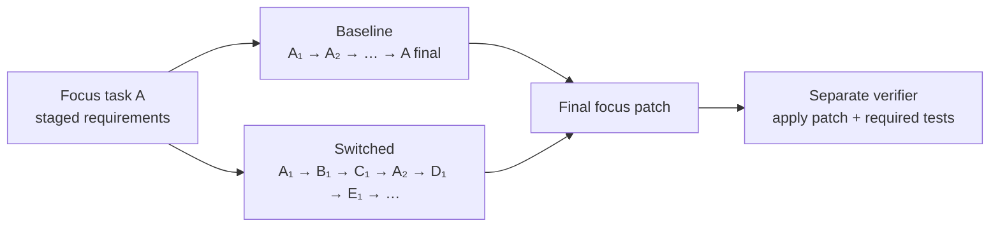

# Switch-SWE

**Can a coding agent return to an unfinished task after working on something else?**

Switch-SWE tests task resumption inside a continuous coding conversation. An agent
works on a focus task, handles requests for four other tasks in the same repository,
then returns to finish the focus task. Each task has its own persistent checkout.
A matched, uninterrupted baseline provides a comparison for final focus-task
resolution.

This repository contains the **frozen 200-pair benchmark** and the **Resumption
Context Manager (RCM) plugin for OpenCode**. The benchmark was developed under
the name SessionSwitchBench.

| Dataset | Focus tasks | Baseline sessions | Switched sessions |
| --- | ---: | ---: | ---: |
| Near — same source-directory locality | 100 | 100 | 100 |
| Far — different source-directory locality | 100 | 100 | 100 |
| **Total, across 19 Python repositories** | **200** | **200** | **200** |

The release preserves `fixed200-v1`, prompt revision
`inplace-clarification-20260916`. The 400 session records are copied byte for
byte from the frozen effective case file. This replaces the earlier 500-task
draft.

## The task

Real coding conversations contain unfinished work: requirements arrive in stages,
another issue interrupts, and the agent must recover the right requirements,
partial implementation and next action when the original task returns.
Switch-SWE turns this into an executable repository task.



*Illustrative schedule. Each released case supplies its exact request order.*

Near and far describe interruption locality within the same repository. Near
tasks modify different source files that share an immediate parent directory;
far tasks use different immediate parent directories. The two groups contain
different focus tasks. See the [data card](docs/data-card.md) for the precise
construction rule and preserved historical exceptions.

Only the final focus patch is scored. Interruption tasks create competing work
and conversation history; they are not additional scored targets.

## What's included

```text
data/
  pairs.json                 200 targets, split labels and paired case IDs
  cases.json                 400 frozen baseline / switched sessions
  splits/{near,far}.json      100 pair IDs per group
  workspace_overlays.json    Initial checkout changes, indexed by case
  blobs/                     856 content-addressed initial source files
  provenance.json            Original candidate versions and source hashes
plugins/context-manager/     Selected OpenCode RCM v003 implementation
scripts/                     Integrity checks, case inspection, source preparation
docs/                        Data card, protocol and provenance
release_manifest.json        SHA-256 inventory of all dataset files
```

The initial-source overlays matter: checking out a base commit alone does not
reproduce every prepared task. The included preparer applies these files and
creates an independent Git history containing only the initial snapshot.

Private grading tests, reference solutions, dependency bundles and runtime
images are maintained separately. This repository provides the frozen task
inputs and source preparation, rather than a self-contained reproduction of
the original cluster evaluation.

## Quick start

Dataset inspection needs Python 3.10+ with no third-party packages.

```sh
# Verify all 200 pairs, split membership, frozen prompts and source blob hashes.
python3 scripts/verify_release.py

# Browse the two groups.
python3 scripts/inspect_case.py --split near
python3 scripts/inspect_case.py --split far

# Inspect one session, or print just its first prompt.
python3 scripts/inspect_case.py --case-id sf001_switched
python3 scripts/inspect_case.py --case-id sf001_switched --turn 0
```

Verification reports `pass`, 200 pairs, 400 cases, 100 near / 100 far,
19 repositories and 856 source blobs.

To prepare a case on Linux, first preview its pinned repository requirements:

```sh
python3 scripts/prepare_workspaces.py \
  --case-id sf001_switched \
  --repo-cache /path/to/repo-cache \
  --out-dir /path/to/new-case \
  --dry-run
```

The plan prints the required commits and manual cache preparation commands.
After preparing the bare repository cache and output parent, run the same
command without `--dry-run`. The output contains `w00/` through `w04/`, each
with an independent initial snapshot. Existing outputs are never overwritten.
See [workspace preparation](docs/workspaces.md) for the complete contract.

When running an agent, expose one prompt at a time and mount the corresponding
prepared directories at `/work/w00`, etc. Keep the dataset and controller
metadata outside the agent's workspace. The frozen final prompt requests a
complete patch in JSON; the historical grader evaluates that submitted patch.

## Resumption Context Manager for OpenCode

RCM assembles context for the task currently being resumed. A task-history
router selects relevant exchanges; task-state memory retains requirements,
progress and next steps. The complete native session stays stored.


*Method illustration from the local manuscript. “Task A” is illustrative:
the plugin routes from agent-visible conversation history, without benchmark
focus labels.*

The included **v003** runtime matches the selected development and evaluation
snapshots. Compatibility was tested with the pinned **OpenCode 1.18.2** binary.
There is no npm dependency installation or build step.

```sh
OPENCODE_UPSTREAM_BIN=/absolute/path/to/opencode \
  ./plugins/context-manager/opencode_plus run "Your coding request"
```

| Mode | Context policy |
| --- | --- |
| `off` | Native OpenCode; the wrapper adds no plugin |
| `a` | Task routing and relevant original history |
| `x` — default | Task routing plus evidence-linked task-state memory |

Set `OPENCODE_CONTEXT_MODE` to choose a mode. The auxiliary analyzer needs an
explicit OpenAI-compatible provider endpoint and API key in the OpenCode runtime
configuration and makes additional model calls. Use the
[plugin guide](plugins/context-manager/README.md) for provider setup, state
isolation, fallback behavior and tests.

The integration checks use a simulated provider. They verify context behavior
and preservation of native history; they do not establish a benchmark score
improvement.

## Evaluation and reporting

Report baseline and switched resolution on the **same compatible set of graded
pairs**, along with that set's size and its missing or ungraded arms:

```text
paired gap (percentage points) = baseline resolution (%) − switched resolution (%)
```

Report near and far separately. Include prompt revision, model and adapter,
context mode, runtime, grading contract and budget. For RCM runs, account for
auxiliary routing and memory calls when reporting cost.

The frozen cohort includes historical differences in some paired request texts
and final target references. It also includes authored follow-ups and
development-time model feedback. These are documented in the
[data card](docs/data-card.md), rather than hidden by rewriting the release.

The local paper and experiment archives contain partial campaigns and draft
result tables with differing coverage. They are not presented here as a
complete 200-task leaderboard. The [evaluation protocol](docs/evaluation.md)
explains strict submission scoring, resource limits, failure accounting and
historical result compatibility.

## Verification and provenance

```sh
python3 scripts/verify_release.py
python3 -B -m unittest discover -s tests -v
node --test plugins/context-manager/test/*.test.mjs
python3 -B plugins/context-manager/test/wrapper_test.py
```

The JavaScript tests use Node 24. The plugin guide also provides integration
tests against the actual pinned OpenCode executable.

The frozen case SHA-256 is:

```text
a47fefc8d3fc7251a25a56c74e5dd56637c7507cde1bcb085d921cf47d77da86
```

See [release provenance](docs/provenance.md) for the source-selection evidence,
reproducible exporter and manuscript material used in this documentation.
The [validation record](docs/validation.md) lists the checks run on this package.

## License

Original project code is covered by [MIT](LICENSE). Repository-derived material
retains its upstream licenses; see [third-party notices](THIRD_PARTY_NOTICES.md).
The plugin retains its source repository's [MIT license](plugins/context-manager/LICENSE).
